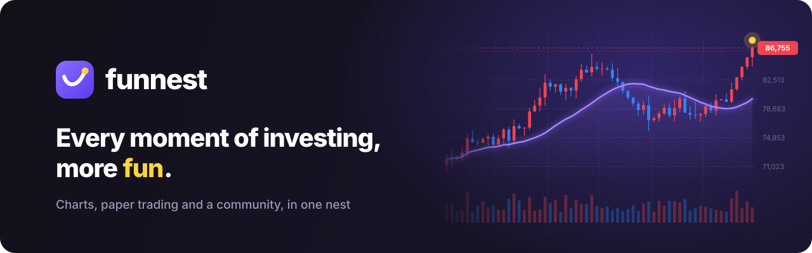

<div align="center">



<br>

[](https://funnest.xyz)&nbsp;[](https://funnest.xyz/trade/)&nbsp;[](https://charts.funnest.xyz)&nbsp;[](https://www.npmjs.com/package/@funnest/charts-react)&nbsp;[](https://github.com/funnest-xyz/funnest-charts)

</div>

<br>

**Funnest**는 투자를 더 재밌게 만들고 있어요.
차트를 보고, 가상 자금으로 연습하고, 내가 만든 지표를 나누는 일을 한 곳에서 할 수 있게요.

<br>

## 📈 만들고 있는 것

<table>
<tr>
<td width="50%" valign="top">

### Funnest 터미널

**[funnest.xyz/trade](https://funnest.xyz/trade/)**

- 국내·미국 주식과 코인(업비트, 빗썸, 바이낸스 선물, 하이퍼리퀴드)을 한 화면에서
- 가상 자금으로 주식·코인·선물 모의투자
- 직접 만든 지표를 공유하고 백테스트하는 커뮤니티, 팔로우
- 다 같이 시장을 보는 실시간 채팅

</td>
<td width="50%" valign="top">

### Funnest Charts

**[funnest-xyz/funnest-charts](https://github.com/funnest-xyz/funnest-charts)** · Apache-2.0

- 투자 앱에 넣는 트레이딩 차트 (iframe 없이 내 페이지 안에서)
- 대시보드용 가벼운 SVG 차트
- 한국 시장 기본값: KST, KRX 호가 단위, 빨강 상승 · 파랑 하락
- CLI와 MCP 서버로 AI 에이전트도 차트를 그려요

</td>
</tr>
</table>

<br>

## 📦 패키지

| 패키지 | 하는 일 |
|---|---|
| [`@funnest/charts`](https://www.npmjs.com/package/@funnest/charts) | 캔버스 차트 엔진 |
| [`@funnest/charts-ui`](https://www.npmjs.com/package/@funnest/charts-ui) | 툴바, 그리기 도구까지 갖춘 트레이딩 화면 (프레임워크 무관) |
| [`@funnest/charts-react`](https://www.npmjs.com/package/@funnest/charts-react) | React용: 트레이딩 위젯과 SVG 선·영역·막대 차트 |
| [`@funnest/charts-viz`](https://www.npmjs.com/package/@funnest/charts-viz) | 웹과 React Native가 함께 쓰는 차트 계산 (눈금, 경로, 스크러빙) |
| [`@funnest/charts-cli`](https://www.npmjs.com/package/@funnest/charts-cli) | 명령줄에서 차트 그리기 (SVG·PNG·HTML), 데이터에 맞는 차트 추천, React 코드 생성 |
| [`@funnest/charts-mcp`](https://www.npmjs.com/package/@funnest/charts-mcp) | AI 에이전트용 MCP 서버: 차트 렌더링, 추천, Datafeed 템플릿 |

```bash
npm i @funnest/charts-react
```

```tsx
import { FnChart } from '@funnest/charts-react';

<FnChart datafeed={myDatafeed} symbol="005930" resolution="1D" />
```

자세한 사용법은 [문서](https://charts.funnest.xyz/docs/)에 있어요.

<br>

## 💬 함께하기

- 차트에 버그나 제안이 있으면 [이슈](https://github.com/funnest-xyz/funnest-charts/issues)로 알려 주세요. PR도 환영해요.
- 서비스에 대한 의견은 터미널 오른쪽 아래 **고객센터**로 보내 주세요. 운영자가 직접 읽어요.

<br>

<details>
<summary><b>English</b></summary>

<br>

**Funnest** is making investing more fun: charts, paper trading and a community for sharing your own indicators, in one place.

- **[Funnest Terminal](https://funnest.xyz/trade/)** — Korean and US stocks and crypto (Upbit, Bithumb, Binance Futures, Hyperliquid) on one screen, paper trading with virtual money, indicators you write, share and backtest.
- **[Funnest Charts](https://github.com/funnest-xyz/funnest-charts)** — Apache-2.0 financial charts for investment apps: a trading chart that runs in your page, lightweight SVG charts for dashboards, a CLI and an MCP server. Docs at [charts.funnest.xyz](https://charts.funnest.xyz).

</details>

<br>

<div align="center">

<br>
<sub>오늘도 즐겁게 투자해요</sub>
</div>
